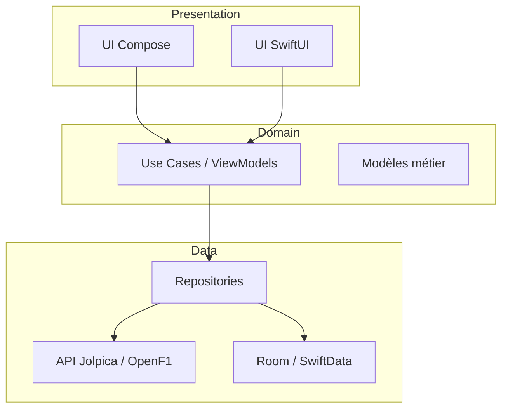

# 🏁 Apex Lap — Application mobile F1

Projet sérieux de développement mobile natif à présenter chez Unistallar : une app F1 moderne, **Android en Kotlin** et **iOS en Swift**, avec suivi live, données historiques et comparaison de pilotes.

---

## 1. Concept

**Apex Lap** est le compagnon du fan de F1 : calendrier de la saison, live timing pendant les séances, classements, profils pilotes/écuries et comparateur de tours. L'objectif est de démontrer une vraie maîtrise du développement natif double plateforme : architecture clean, temps réel, data visualisation, offline-first et tests.

## 2. Fonctionnalités principales

### MVP (v1 — ~6 à 8 semaines)
- **Calendrier de la saison** : Grands Prix, sessions (EL, qualifs, sprint, course), compte à rebours.
- **Résultats & classements** : résultats de course, championnats pilotes et constructeurs.
- **Fiche pilote / écurie** : palmarès, statistiques, casque et couleurs.
- **Mode hors-ligne** : cache local des dernières données consultées (Room / SwiftData).

### v2 — différenciateurs techniques (le « sérieux » du projet)
- **Live timing** pendant les séances : positions, écarts, secteurs, via WebSocket/temps réel.
- **Comparateur de tours** : superposition de deux pilotes sur un tour (secteurs, vitesse, freinage).
- **Notifications push** : départ de course, drapeau rouge, victoire.
- **Widget d'écran d'accueil** : prochaine session (Glance sur Android / WidgetKit sur iOS).
- **Graphiques de performance** : évolution du championnat, tableau de vitesse.

## 3. Stack technique

| Domaine | Android | iOS |
|---|---|---|
| Langage | Kotlin | Swift |
| UI | Jetpack Compose | SwiftUI |
| Architecture | MVVM + Clean Architecture | MVVM + Clean Architecture |
| Injection | Hilt | SWIFT Injection / Factory manuelle |
| Réseau | Retrofit / Ktor + kotlinx.serialization | URLSession / Alamofire + Codable |
| Temps réel | Ktor WebSocket ou OkHttp WS | URLSessionWebSocketTask |
| Base locale | Room | SwiftData (ou Core Data) |
| Async | Coroutines + Flow | async/await, Combine ou Observation |
| Tests | JUnit, Turbine, Compose UI tests | XCTest, Swift Testing |
| CI | GitHub Actions (build + tests + lint) | GitHub Actions + Xcode Cloud |

**Module transversal (bonus très apprécié)** : un petit backend partagé (Kotlin Multiplatform ou API simple) pour agréger les données — montre une réflexe multiplateforme.

## 4. Source de données

- **Jolpica-F1** (succession d'Ergast, API REST gratuite, sans auth) : calendrier, résultats, qualifs, classements, historique complet. ([jolpica-f1](https://github.com/jolpica/jolpica-f1))
- **OpenF1** (openf1.org) : télémétrie et données temps réel — attention, licence non commerciale (usage éducatif/fan) ; pour un usage commercial, prévoir une licence dédiée ou une alternative type Orange Cat Blacktop.

Pour un projet vitrine chez Unistallar (qui fait du dev app), Jolpica suffit largement ; OpenF1 peut être ajouté en mode démo pour le live timing.

## 5. Architecture cible

- **Offline-first** : le repository sert le cache, puis rafraîchit depuis l'API (pattern *single source of truth*).
- **Design system** : thème sombre « F1 night race », typographie racing, animations fluides.
- **Tests** : coverage sur les use cases et les mappers de données ; tests UI sur les parcours clés.

## 6. Découpage en sprints (suggestion)

1. **Sprint 1** — Setup des deux repos, CI, design system, modèle de données.
2. **Sprint 2** — Calendrier + compte à rebours (les deux plateformes en parallèle).
3. **Sprint 3** — Résultats & classements + cache offline.
4. **Sprint 4** — Fiches pilotes/écuries + recherche.
5. **Sprint 5** — Live timing (OpenF1) + notifications.
6. **Sprint 6** — Comparateur de tours + graphiques + widgets.
7. **Sprint 7** — Polish, tests, screenshots Store, README de présentation.

## 7. Pourquoi c'est un bon projet vitrine

- Couvre un large éventail de compétences mobiles : réseaux, temps réel, persistance, UI animée, widgets, notifications, tests, CI.
- Deux codebases natives distinctes (Kotlin ET Swift) — exactement ce qu'attend une équipe dev app.
- Un domaine fun et parlant (la F1) qui rend la démo mémorable.
- Périmètre modulaire : le MVP est atteignable seul, chaque module suivant est valorisable indépendamment.

## 8. Prochaines étapes

1. Valider le périmètre MVP avec ton équipe chez Unistallar.
2. Créer le repo GitHub (mono-repo `apex-lap` avec `android/` et `ios/`).
3. Brancher Jolpica et afficher le calendrier 2026 sur les deux plateformes.
4. Mettre la CI en place dès le premier jour.